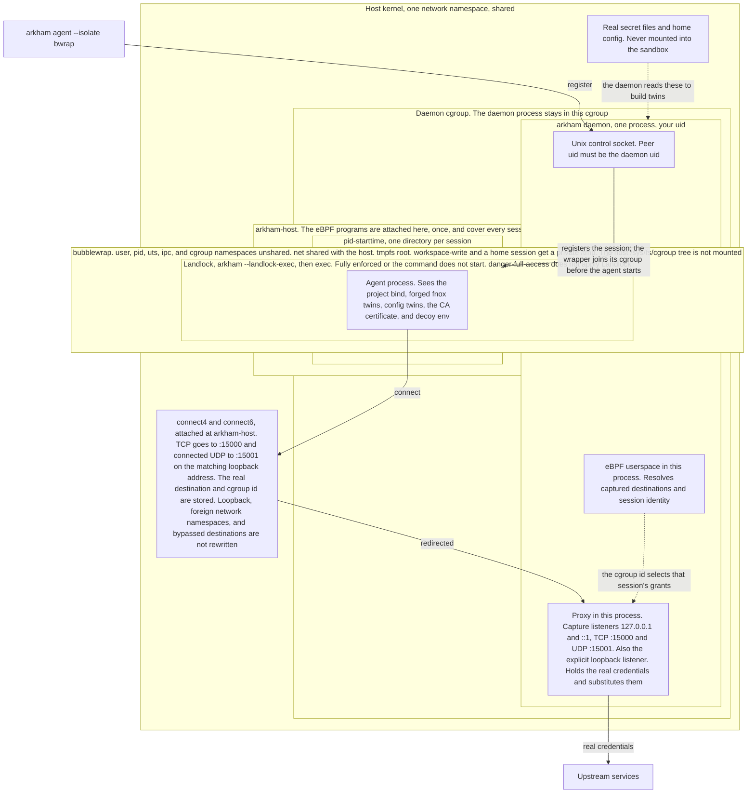

# arkham

Give your coding agent fake credentials that work. arkham is a secure agent environment. Your agent holds only format-valid decoys and works exactly as before. The real secrets stay in fnox. arkham swaps a decoy for the real value transparently, only on hosts you allow, and swaps it back on the response. Protect your secrets without changing how you work.

A leaked prompt, a pasted log, or a dependency that phones home carries the decoy. The upstream rejects it everywhere except the grant. The real value appears on the wire only to a host you named.

One command drops you into that environment. `arkham agent` starts the stack and opens a shell in a container that holds only decoys. Supported traffic is captured transparently without proxy settings, subject to capture exclusions.

Underneath sits a grant-scoped proxy. A workload can also point its proxy settings at arkham, or on Linux arkham can capture its traffic with `--proxy-backend ebpf`. On a grant match arkham terminates TLS with a per-domain leaf signed by its own CA and swaps the decoy for the real value in headers, basic auth, and bodies, over HTTP/1 and HTTP/2. On the response it swaps real values back to decoys. Every other connection is spliced byte for byte with the real upstream certificate untouched.

## Protocols

| Protocol | Description |
| --- | --- |
| HTTP/1 | Headers, basic auth, and bodies rewritten both directions behind a per-domain TLS leaf. |
| HTTP/2 | Same rewriting over HPACK heads and DATA frames, picked by ALPN. |
| SSH | Terminates on decoy keys, presents the real identity upstream, never opens forwarding. |
| PostgreSQL | Negotiation answered here, startup identity swapped, steady state equal-length relay. |
| Redis | RESP `AUTH` and `HELLO` passwords swapped. A TLS leaf is minted for the scope host when the client sends no SNI. |
| SMTP | `AUTH PLAIN`, `AUTH LOGIN`, `AUTH XOAUTH2`, and `AUTH OAUTHBEARER` credentials swapped on cleartext the same way as on TLS. `STARTTLS` upgrades the same sockets; `smtps://` is TLS from the first byte. |
| LDAP | Simple-bind password swapped. StartTLS and LDAPS mint a leaf for the scope host when the client sends no SNI. |
| NATS | CONNECT `user`/`pass`, `auth_token`, nkey public key, or user JWT swapped on cleartext the same way as on TLS. Nkey and user JWT also need the server INFO nonce and a signature that verifies under the decoy. `tls://` upgrades after the server's INFO line; `handshake_first` is TLS from the first byte. Message payloads are never rewritten. |
| AMQP | SASL `PLAIN` user and password swapped in the 0-9-1 `connection.start-ok` and the 1.0 `sasl-init` on cleartext the same way as on TLS. Other mechanisms pass through. Close and error texts that carry the real password reach the client as the decoy. |
| Raw TCP | Equal-length byte swap that never reframes; everything else splices untouched. |

## Install

**From a release** (Linux, amd64 and arm64), with the installer script:

```sh
curl --proto '=https' --tlsv1.2 -LsSf \
  https://github.com/casualjim/arkham/releases/latest/download/arkham-installer.sh | sh
```

**With mise**, which installs the release tarball for your platform:

```sh
mise use -g github:casualjim/arkham
```

Or download a tarball from [the releases page](https://github.com/casualjim/arkham/releases) and put `arkham` on your `PATH`.

**As a container**: `ghcr.io/lotsaai/arkham`. The image is runtime-only, entrypoint `arkham`, default command `serve`.

```sh
docker run --rm ghcr.io/lotsaai/arkham:latest fake GH_TOKEN
```

**From source**: clone, then build with a recent stable Rust toolchain (the crate uses edition 2024):

```sh
git clone https://github.com/casualjim/arkham
cd arkham
cargo build --release
```

The `ebpf` backend additionally needs a nightly toolchain (the BPF target has no prebuilt `core`, so `aya-build` uses `-Z build-std`) and [`bpf-linker`](https://github.com/aya-rs/bpf-linker) to link the programs; both are pinned in `mise.toml`, so `mise run build` provides them.

## Try it in 30 seconds

You need docker and your secrets in fnox. Install arkham, name your source directories once, then step into any workspace as a secure agent.

```sh
mise use -g github:casualjim/arkham
mkdir -p ~/.config/arkham
cat > ~/.config/arkham/config.toml <<'EOF'
[workspace]
# source directories you want beside your workspace
include = ["~/projects"]
EOF

cd ~/projects/my-awesome-thing
arkham agent
# do work, exit the agent
arkham down
```

Container home, shell, listener, and CA all default, so that file is the whole setup. `arkham agent` generates the stack, starts it, and drops you into the agent. The agent holds only decoys. Real values stay in fnox and reach only granted hosts. `arkham down` stops the devenv.

To see the raw credential swap from both sides of the wire, follow the [tutorial](docs/user/tutorial.md).

## The shape of a config

```toml
[rules.github_token]
env = "GITHUB_TOKEN"          # decoy seed, registry key, fnox key
allow = ["https://api.github.com"]
```

That file is the whole config. The listener defaults to `127.0.0.1:8080` and the CA to `/certs/ca.pem` when the stack mounted it there, else `<config-dir>/arkham/ca.pem`. Start the proxy, hand your agent its decoy, and the rule is live:

```sh
arkham serve
arkham fake GITHUB_TOKEN    # the value the agent holds
```

`env = "GITHUB_TOKEN"` alone is a complete rule when the bundled known-host registry knows the name: the registry supplies the hosts and the decoy shape, and [fnox](https://fnox.jdx.dev) supplies the real value at serve time (age, 1Password, Vault, Bitwarden, AWS Secrets Manager, the OS keychain, and the rest of its provider catalog; no fnox binary needed). Most workspaces state no rules at all: every fnox-declared name the registry knows becomes a rule at serve time, and config holds overrides only.

When the registry entry declares the service's OAuth2 flow, freshly issued tokens are covered too: the proxy rewrites the token endpoint's response so the agent holds a minted decoy, and swaps it back on every later request. `arkham registry from-oidc` / `from-openapi` turn a vendor's discovery or OpenAPI document into that entry.

## Documentation

Everything lives under [docs/user](docs/user/README.md), arranged by what you need:

- [Secure your workspace](docs/user/how-to/confine-a-workspace.md) — run a coding agent with decoys only. Start here.
- [Tutorial](docs/user/tutorial.md) — one credential swap through the raw proxy, end to end, both sides of the wire.
- How-to guides — [capture traffic transparently](docs/user/how-to/capture-traffic-transparently.md), [get values from fnox](docs/user/how-to/get-values-from-fnox.md), [extend the registry](docs/user/how-to/extend-the-registry.md), [trust the CA](docs/user/how-to/trust-the-ca.md).
- Reference — [CLI](docs/user/reference/cli.md), [configuration](docs/user/reference/configuration.md), [allow entries](docs/user/reference/allow-entries.md), [decoy patterns](docs/user/reference/decoy-patterns.md), [registry](docs/user/reference/registry.md).
- Explanation — [how arkham works](docs/user/explanation/how-it-works.md), [the security model](docs/user/explanation/security-model.md) (what it defends against and what it does not).

Two runnable examples ship in the repository:

- [examples/agentic-devenv](examples/agentic-devenv/README.md) — a workspace to secure with `arkham up`: one arkham container, one agent container holding only decoys, transparent capture, and real values that stay in fnox.
- [integration](integration/README.md) — the compose demo behind `mise run demo`. The scenario table there is what the client asserts.

## Linux host mode

`arkham daemon` and `arkham agent --isolate bwrap` are the Linux host path. The container quickstart above is a different one.



Filesystem isolation is bubblewrap plus Landlock. The network is shared with the host; captured TCP and connected UDP are redirected to the proxy, which alone holds the real credentials, and the cgroup id is how the proxy tells which session's grants apply. Discovery uses project markers, and fnox only decides which files get rewritten.

Host sessions hide the configured CA private key and the contents of Arkham config that exists at launch, including discovered hard-link aliases. Unrelated project `.config` files remain usable. Missing config paths are not reserved, and an existing symlink entry can still be replaced even though its original target stays masked.

## Where the limits are

arkham matches the request authority, not the path. An agent that hashes or signs the credential before sending defeats substitution, and the upstream rejects the request. A `*` grant host matches any destination. A client must trust arkham's CA to reach a granted HTTPS host. Transparent capture requires Linux, kernel 5.15, `CAP_BPF`, and `CAP_NET_ADMIN`. The eBPF backend captures IPv4 and IPv6; hosts without IPv6 support run IPv4-only. [The security model](docs/user/explanation/security-model.md) states the capture boundaries and their consequences.

## Contributing

Read [AGENTS.md](AGENTS.md) before you change the code.

License: Apache-2.0.
