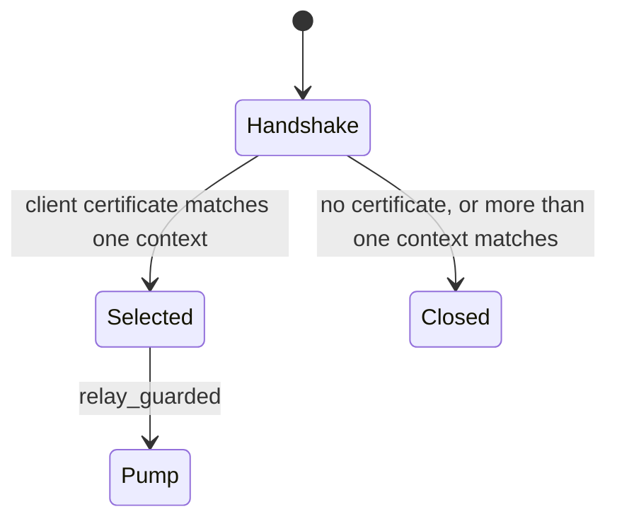
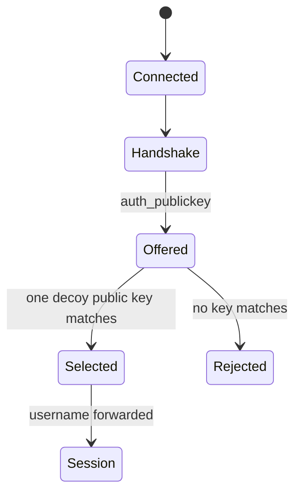

# Per-context grant identity

Several contexts in one kubeconfig, Talos config, NATS directory, or SSH config can share a destination and still be different subjects. This note is the contract for choosing among them. The helper in `arkham_config::context` names each subject and fails when two of them cannot be told apart on one destination. Adapter and proxy changes belong to #62, #63, #64, and #65.

The choice uses the destination host and port and the decoy the guest presents. Kubernetes presents that decoy as a bearer token on a per-user endpoint. Talos presents a client certificate. SSH presents a public key. NATS presents CONNECT fields. The operator sets no new key. The proxy terminates the guest session and opens its own upstream session. Real credentials stay on that upstream leg.

`current-context`, the Talos `context` key, and NATS `context.txt` copy the host's current value into the guest. The proxy does not read that pointer when it chooses a credential. Changing the pointer inside the guest changes the guest's default command. `kubectl --context`, `talosctl --context`, and `nats --context` work because every granted context is in the decoy file with its own decoy. `kubectl config use-context`, `talosctl config context`, and `nats context select` rewrite the pointer. The sibling issues mount the generated decoy so those writes succeed, and they leave the host file unmounted for writes.

## One subject, one identity

`identities` is the constructor adapters call while they write grants. `require_distinct` is the check for two identities that present the same host, port, and decoy bytes. `Grant::matches` stays the only host matcher. A repeated path, protocol, and name keeps the first record. The path is stored as the adapter passed it.

The canonical bytes are the protocol tag, U+001F, the path, U+001F, and the name. `key_seed()` is SHA-256 of those bytes. There is no MAC key. The label, which is also the client-pair stem, is the tag, `-`, and the first 32 hex characters of that digest. The env name is the label with `-` replaced by `_` and ASCII letters uppercased. `secret()` is `fake_for` of that env with no pattern, which hashes the env again with no key. A caller who knows the path and the name can recompute the decoy. That is the same unkeyed scheme `fake_for` already uses.

`prod` and `Prod` both succeed and stay distinct, because the original spelling is part of the canonical bytes. An empty name fails. A name or path that contains U+001F fails, so two different pairs cannot encode to the same bytes. A long name, including an EKS cluster ARN, still gets a label. The label is 32 hex characters plus the tag, so it does not grow with the path or the name, and it does not contain the home directory.

For source `/home/ivan/.ssh/config`, protocol `Ssh`, and name `git`, the label and the pair stem are `ssh-13786934f8941a5f07bb7b5b084cc9e8`. The env is `SSH_13786934F8941A5F07BB7B5B084CC9E8`.

`require_distinct` trims the host and stores the ASCII lowercase form. An empty host after trimming is `WireHostEmpty`. Brackets stay on the host. The port is the caller's port. The group key is that host, that port, and the decoy bytes. Two empty slices compare equal. The same identity repeated is success. The same identity on two destinations is success. Two different identities on one key return `AmbiguousContexts`. The parties are sorted by path, name, and tag. The message lists them with commas and omits the decoy bytes. Two different refs that share a label return `ContextCollision`.

`secret()` does not consult the registry. An env built this way can still contain a bundled `contains` needle, so a later call to `Registry::template` can pick a bundled pattern. That gap is #71.

## Kubernetes

#62 calls `identities` once per distinct user with `KubernetesUser`, and once per distinct cluster with `KubernetesCluster`. Contexts that share a user share that user identity. Contexts that share a cluster share that cluster's label for the CA file. One user is one rule. The allow list is every server that user talks to. The same server and the same user are one grant. `current-context` is not an input.

The host keeps the auth its kubeconfig already has. A bearer stays the grant value. A client certificate and key stay the upstream identity. A user who has only a certificate gets an empty grant value, and the request machine removes that user's decoy `Authorization` bearer so the apiserver sees the client certificate alone. Toward the guest, every user gets one decoy. That decoy is `secret()` as an HTTP bearer, and the decoy cluster is plain TLS to arkham's CA. The decoy file carries no client certificate and no client key. Exec-plugin users and auth-provider users stay out of the grants. That work is #72. An auth-provider block is dropped from the guest file so its secret does not reach the guest.

A context is a cluster server, a user, and a namespace. The server URL does not distinguish two users of one cluster. Compose gives each of those users a distinct guest port in `49152..=65535` and writes `upstream_port` on that allow entry's tls table. The guest port is the allow entry. The proxy dials `upstream_port` when it is set, and the entry port otherwise. One user on a server keeps the real URL, and `upstream_port` stays unset. Two contexts that share a user and a server stay one endpoint.

`require_distinct` groups host, port, and decoy bearer bytes. Two different users whose decoy bearers match on one host and port are `AmbiguousContexts`, and the message names both. The same user repeated is success.

Grants for one guest host and port must agree on the client certificate, the client key, `guest_tls`, and `upstream_port`. Disagreement is `AmbiguousHttpsGrants`, and the message names the grants. The relay offers that one upstream identity. The request machine substitutes the grants for that guest port. The response machine redacts every real value that dials the same upstream host and port, including a user who reaches that apiserver through a different guest port.

In `/home/ivan/.kube/config`, contexts `prod` and `prod-system` both use user `ivan` and server `k8s.example` on port 6443, and differ by namespace. That is one endpoint. Context `prod-admin` uses user `admin` on that same server, so compose points `ivan` and `admin` at two guest ports and sets `upstream_port` to 6443 on both. Context `staging` uses `ivan` on a different server and keeps that server's URL.

When two users on one guest host and port present the same bearer bytes, `require_distinct` names both and #62 writes no grant for that server.

`KUBECONFIG` is a list split on `:`. #62 reads each file in order and merges it the way kubectl does. A context, cluster, or user name that is already defined stays as it is. A new name is added. `current-context` is the first non-empty value. The winning entry's source path is the file that defined it, so an identity from another file is a different label. A later file's `prod` does not replace the earlier `prod` and is not a second guest context. An empty value means `~/.kube/config`. Host `kubectl --context` is left unread. Context selection stays on the wire.

## Talos

The Talos adapter calls `identities` once per context, with protocol `Talos`. One grant per context. Each context gets its own guest pair at the label. The Talos `context` key is left unread. `TALOSCONFIG` is one path. talosctl does not split it on `:`. An empty value means `~/.talos/config`.

Selection waits until the handshake shows the client certificate. `relay_guarded` pumps after that choice. There is no new buffer.



In `/home/ivan/.talos/config`, contexts `prod` and `prod!` both dial host `talos.example` on port 50000. Those are two identities and two certificates. The certificate selects one. When both contexts carry the same certificate bytes, `require_distinct` names `prod` and `prod!` at `talos.example:50000`.

## NATS

One call per `context/<name>.json`, with protocol `Nats` and the name taken once. The source is the json path. Password and token are `secret()`. Nkey and creds use `key_seed()`. `context.txt` is left unread. `NATS_CONTEXT` and `XDG_CONFIG_HOME` are left unread. The directory stays `{host_home}/.config/nats`.

The proxy reads the url host and port, then CONNECT fields inside `Policy::swap`, still capped by `MAX_COMMAND` at 16 KiB. #64 collects every grant whose decoy fields match, including a match that is later in label order. No match forwards the line. `relay_guarded` pumps after the grant is chosen. There is no new buffer.

```mermaid
stateDiagram-v2
  [*] --> Connected
  Connected --> Reading: destination host and port
  Reading --> Selected: CONNECT matches one decoy
  Reading --> Forward: CONNECT matches no grant
  Selected --> Pump: relay_guarded
  Forward --> Pump: Policy::Forward, no real credential
```

`Error::NatsSharedEndpoint` stays the dial and TLS clash. `AmbiguousContexts` is the separate case of two decoys that present the same bytes.

A cleartext `nats` upstream uses `Policy::Forward` and writes no real credential. There is nothing to select and nothing to protect, including when two cleartext contexts share a host and port. Both forward. `require_distinct` is not called for them.

In `/home/eng/.config/nats`, contexts `demo` and `Demo` both use tls on host `nats.example` port 4222. The passwords differ because the identities differ. A CONNECT that carries one password selects that context. When both contexts were given the same decoy CONNECT bytes, `require_distinct` names both.

## SSH

One call per host block the existing adapter already grants. The name is `HostName` or `patterns[0]`. This change leaves `*`, `?`, `!`, `Include`, and `Match` unparsed. The decoy key is seeded from `key_seed()`. #65 adds `SshKey::from_seed`. The username is forwarded. Nothing compares it with a grant field. Password auth stays rejected. SSH selection happens in the existing `auth_publickey` callback. It does not add a buffer in front of the session, and it does not go through `relay_guarded`.



`RewriteCollector::twin` mounts `decoy_files` from the first entry only. #65 puts every host's decoy private key on that first entry. This change leaves `twin` as it is.

In `/home/ivan/.ssh/config`, blocks `git` and `git.example` both resolve to host `github.com` port 22. The label for `git` is `ssh-13786934f8941a5f07bb7b5b084cc9e8`. The offered public key selects the block. When both blocks present the same decoy public key, `require_distinct` names `git` and `git.example` at `github.com:22`.

## Guest material and old files

The guest file receives `secret()`, the certificate named by the label, or the public half of the seeded key. A Kubernetes guest receives `secret()` as a bearer and does not receive a guest certificate. A destination with no matching grant splices.

Adopting the helper changes the label, the env, and the pem file name. Nothing copies an old pair onto the new name. `load_or_generate_client_pair` mints a new pair on the first adapt after the switch. `write_state` removes a stale file whose name starts with `kube-`, `talos-`, `ssh-`, `git-`, or `nats-` when that name is not in the current set. Older slug files that do not start with those prefixes stay until a sibling removes them. NATS nkeys and SSH keys become stable on the first adapt that uses `key_seed()`.

## Outside this change

The following stay out of this change:

- Exec and auth-provider credential plugins. That work is #72.
- Guest-side mTLS for Kubernetes. The guest presents a bearer. The proxy presents the host client certificate upstream.
- `twin`
- Wildcard SSH
- `SshKey::from_seed`
- A new crate
