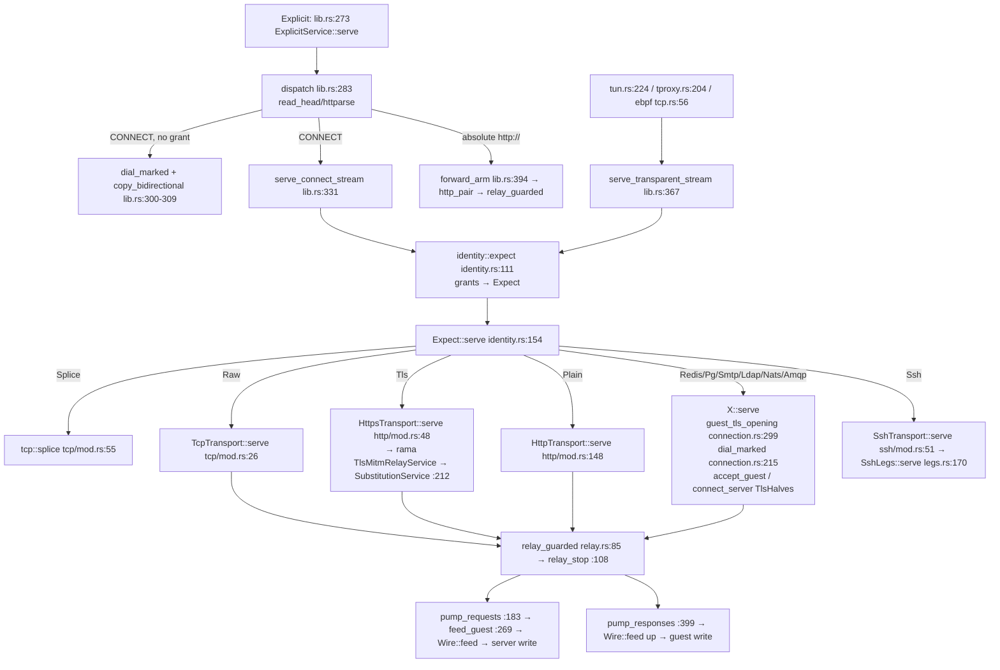
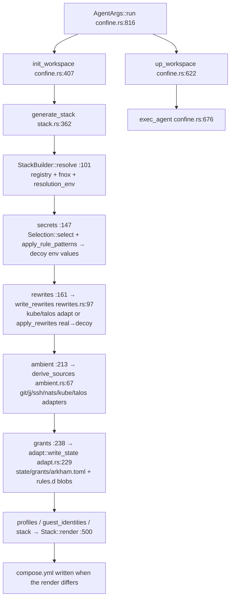

# arkham architecture map

Written from `origin/main` @ `ebd9578`. The TLS-leg sections were updated when `accept_guest` and `connect_server` became default methods on `TlsHalves`. Line numbers in files this change did not touch are still from that commit. Crate prod-line totals are still from that commit. `AGENTS.md` and the rest of `docs/` were not used as sources. All paths are relative to the repo root, and `proxy/` means `crates/arkham-proxy/src/`.
**Prod lines** are non-test lines, so `#[cfg(test)]` items, `e2e/`, `fuzz_props.rs`, `props.rs`, `harness.rs`, `fixtures.rs` and `test_support.rs` are left out. The count still includes comments. The number in brackets counts code only, without comments or blank lines.

## 1. Crates

| Crate | Role | Prod lines | Key public types/traits (file:line) |
|---|---|---|---|
| `arkham` (bin, `src/`) | CLI with `serve`, `agent`, `init`, `up`, `fwd` and others. Builds `ProxyState` and starts the explicit listener and the capture backend. | 1022 (668) | `Command` main.rs:32; serve path main.rs:176-252; `ServeArgs` commands.rs:30; `fwd::run` fwd.rs:111 |
| `arkham-proxy` | The MITM core: ingress dispatch, protocol pick, TLS legs, relay and substitution engine. **Every protocol vertical lives here.** | 16244 (13019) | `ProxyState` lib.rs:70; `serve` lib.rs:236; `serve_connect_stream` lib.rs:331; `serve_transparent_stream` lib.rs:367; traits in `transports/mod.rs` (§2) |
| `arkham-config` | Config load, rule registry, **grants model**, fake generation, OAuth flows | 8001 (5987) | `AppConfig` config.rs:29; `RuleCfg` config.rs:359; `fake_for` config.rs:917; `Grant` grants/mod.rs:396; `resolve` grants/mod.rs:620; `Registry` registry.rs:133; `OAuthFlow` registry.rs:37 |
| `arkham-compose` | `arkham init/agent/up`: generates the compose stack and rewrites host tool configs into guest decoys plus grant fragments | 6765 (4938) | `AgentArgs` confine.rs:764; `generate_stack` stack.rs:362; `RewriteAdapted` adapt.rs:30; `GrantFragment` adapt.rs:58 |
| `arkham-plugin` | Wasm (wasmtime component) HTTP rewrite hooks | 708 (496) | `RewriteHook` lib.rs:72; `Registry` lib.rs:154; `Registry::select` lib.rs:298 |
| `arkham-pki` | CA, leaf/client-pair minting, SSH keys | 766 (495) | `CertAuthority` ca.rs:30; `generate_domain_cert` ca.rs:129; `boring_pair` ca.rs:140; `generate_domain_pair` ca.rs:365; `SshKey` ssh.rs:23 |
| `arkham-fnox` | Resolves real secret values from fnox | 1095 (785) | `FnoxSource` lib.rs:24; `resolve` lib.rs:437 |
| `arkham-tun` | Userspace TUN capture. Feeds `serve_transparent_stream`. | 1217 (996) | `run_tun` tun.rs:46; call at tun.rs:224 |
| `arkham-tproxy` | nftables TPROXY capture. Feeds `serve_transparent_stream`. | 1049 (759) | `run_tproxy` tproxy.rs:56; call at tproxy.rs:204 |
| `arkham-ebpf` | cgroup sock_addr eBPF redirect capture | 1406 (883); `live.rs` is `#[cfg(test)]` (lib.rs:873) and excluded | `run_ebpf` lib.rs:459; call at tcp.rs:56 |
| `arkham-ebpf-programs` | BPF programs (bpf target only) | 398 (214) | main.rs |

Nothing on main is split into one crate per protocol. Each protocol is spread across three crates:
- `arkham-proxy/src/transports/
/`
- `arkham-config/src/grants/
.rs`
- for some protocols, `arkham-compose/src/
.rs`

## 2. Shared base that protocols must reuse

### 2a. Transport traits: `proxy/transports/mod.rs`
| Item | Line | Signature |
|---|---|---|
| `ServeStream<'a,G,S>` | 44 | `{ guest: G, params: CandidateParams<'a>, scope: &'a S }` |
| `Transport` | 54 | `type Scope: Sync; fn serve<G: AsyncRead+AsyncWrite+Unpin+Send+'static>(&self, ServeStream<'_,G,Self::Scope>) -> impl Future<Output=Result<(),Error>>` |
| `TlsHalves` | 74 | `type Scope; fn accept_guest` and `fn connect_server` have default bodies (tokio-rustls). A protocol implements `tls`, `tls_label`, `root_cert`, `client_paths`. Defaults: `guest_alpn` and `server_alpn` offer nothing; `client_builder` verifies chain and name against the named root, or the platform store when the scope names none. |
| `PairCtx<'a>` | 204 | `{ grants:&[Grant], host:&str, port:u16, plugins:&arkham_plugin::Registry, mint:Option<MintStore> }` |

**How a new protocol plugs in:**
1. Implement `Transport::serve`.
2. Implement `TlsHalves` if it has TLS legs. Supply `tls`. Override `guest_alpn`, `server_alpn`, or `client_builder` only when the wire law differs.
3. Build its `(down, up)` wire pair from `PairCtx`.

`accept_guest` and `connect_server` are default methods. Postgres overrides ALPN (`postgresql`) and `client_builder` (libpq `EgressCertVerifier`). Redis, SMTP, LDAP, NATS, and AMQP use the defaults.

### 2b. TLS caches: `proxy/transports/tls.rs`
| Fn | Line | Signature |
|---|---|---|
| `cached_leaf` | 27 | `(ca:&CertAuthority, leaves:&DashMap<String,Arc<ServerConfig>>, sni:&str, alpn:Option<&[u8]>) -> Result<Arc<ServerConfig>>` |
| `cached_leaf_mtls` | 52 | same args; cache key is mode, ALPN offer, and server name; client verifier on arkham's CA |
| `cached_roots` | 87 | `(roots:&DashMap<RootCert,Arc<RootCertStore>>, root:&RootCert) -> Result<Arc<RootCertStore>>` (Path or System, fails closed if empty) |

These are free functions over the one `TlsCache` built in `ProxyState::new`. The leaf key includes the ALPN offer, so a `postgresql` leaf and a leaf with no ALPN do not collide on the same name.

Related helpers in `proxy/connection.rs`:
| Helper | Line | What it does |
|---|---|---|
| `guest_tls_opening` | 299 | ClientHello, SNI/authority check, `MintBucket::allow` |
| `client_identity` | 95 | Loads the upstream client cert/key |
| `client_auth_policy` | 130 | boring mTLS policy (HTTPS only) |
| `trust_anchors` | 196 | Reads extra trust anchors |
| `dial_marked` | 215 | Dials upstream with an optional fwmark |
| `Prefixed` | 254 | Replays already-read bytes in front of a stream |
| `GuestIo` | 37 | Guest stream wrapper for the rama path |

### 2c. HTTPS stack (rama + boring)
- `ProxyState.relay` / `extra_relays` (lib.rs:72-73) are `TlsMitmRelay<CachedBoringMitmCertIssuer<…>>` (lib.rs:57). They are built by `https_relay` (lib.rs:106), using `CertAuthority::boring_pair` and webpki plus extra anchors per `root_cert`.
- `HttpsTransport::serve` (http/mod.rs:48):
  1. `read_client_hello`
  2. scope via `grant.endpoint(Https)`
  3. `client_auth_policy`
  4. `TlsMitmRelayService::new(relay, SubstitutionService)` (http/mod.rs:124)
- `SubstitutionService` (http/mod.rs:196) picks a machine by the negotiated ALPN:
  - h2: `https_h2_pair` :329
  - http/1.1: `https_pair` :305
  - anything else: `raw_tls_pair` :354
  - then calls `relay_guarded`.
- **Only HTTP/HTTPS use boring.** Every other TLS protocol uses rustls through `TlsHalves`, so there are two TLS stacks.

### 2d. TCP transport + engine
| Piece | File:line | Notes |
|---|---|---|
| `TcpTransport::serve` | tcp/mod.rs:26 | `dial_marked` → `raw_tcp_pair` (:68) → `relay_guarded` |
| `splice` | tcp/mod.rs:55 | Decline path: replay `initial`, then `copy_bidirectional` |
| `Raw` machine | tcp/machine.rs:17 | `new` :28 (equal-length pairs only), `length_changing` :39, `from_pairs` :44, `Wire::feed` :55 (needle hold-back) |
| `Wire` trait | engine/mod.rs:72 | `feed(&mut self, &[u8]) -> Fut<(Rewritten, Vec<Hit>)>` plus `take_reply`, `take_peer_note`/`apply_peer_note`, `take_upgrade`, `arm_upgrade`, `release_handoff`, `local_upgrade` |
| `Rewritten` | engine/mod.rs:57 | `Emit(Cow)` / `Hold` / `Close` |
| `CredentialPair` | :152 | `{needle, replacement, label}` |
| `eligible_pairs` | :160 | `(grants, scheme, host, port, Direction) -> Vec<CredentialPair>` |
| `max_tail_size` | :311 | longest needle − 1 |
| `scan_with_tail` | :342 | |
| `replace_bytes` / `replace_in` | :376 / :400 | |
| `needle_prefix_suffix_len` | :429 | Bytes to hold back |
| `needle_safe_emit_len` | :443 | `(data, pairs, tail_bound) -> usize` |
| Relay | relay.rs | `relay_guarded` :85 → `relay_stop` :108 runs `pump_requests` :183 (→ `feed_guest` :269 → `Wire::feed` → write upstream) and `pump_responses` :399 together. `relay_stop` returns both sockets for STARTTLS-style upgrades (`RelayEnd::Upgrade`). |

**How a new protocol plugs in:** implement `Wire` for a framing machine and pass a `(down, up)` pair to `relay_guarded`, or to `relay_stop` if it needs an upgrade. Unframed bytes should use `Raw`.

### 2e. OAuth / mint
- **Rules:** `OAuthFlow` (registry.rs:37) rides on `Grant::Token.oauth2` (grants/mod.rs:406). Importers are `flow_from_oidc` (import.rs:22) and `flows_from_openapi` (:67).
- **Engine:**
  - `MintPlan` :192
  - `mint_plan_for` :203
  - `minted_pairs` :242
  - `mint_and_redact` :268
- **Store:**
  - `MintStore::mint` (mint.rs:66) renders a decoy with `fake_for(real_value, pattern)`.
  - `MintStore` is what `PairCtx.mint` carries. A clone shares the pair map.
- **Users:** only the HTTP h1 and h2 machines (`http/machine.rs`, `http/h2.rs`). Other protocols get `PairCtx.mint` but never read it.
- **Name clash:** `MintBucket` (mint.rs:135, `ProxyState.mint`) is the *leaf-issuance burst guard*, not OAuth.

### 2f. Grants model: `arkham-config/src/grants/`
- **Types (mod.rs):**
  - `HostPat` :39 (Exact/Wildcard/Any; `matches` :56)
  - `Scheme` :91 (14 variants)
  - `Credential{label,fake,value}` :159
  - `GuestTlsMode` :172
  - `EndpointScope` :183 (scheme, host, port, client_cert/key, root_cert, guest_tls)
  - `SshScope` :207
  - `RootCert` :221
- **`Grant` enum (:396):**
  - `Token{credential, allow:Vec<EndpointScope>, pattern, oauth2}`
  - `Postgres`, `Redis`, `Smtp`, `Ldap`, `Nats`, `Amqp`, each `{credential, scope:Box<XScope>}`
  - `Ssh{allow}`
- **Matchers:**
  - `matches` :484 (dispatches to `XScope::matches` in each `grants/
.rs`)
  - `endpoint` :501
  - per-protocol lookups `postgres/redis/smtp/ldap/nats/amqp/ssh` :514-586
  - `uri_match` :861
- **Build:**
  1. `resolve` :620
  2. `GrantCollector::collect` :642
  3. `RuleCfg::value_scheme` (config.rs:413) routes connection strings to `connection_string` :669, which dispatches to `
::grant` :682-688
  4. everything else goes through `token`/`ssh`.

**How a new protocol plugs in today:** add a `Scheme` variant, a `Grant` variant, a lookup fn, a `value_scheme` branch, a `connection_string` arm, and a `grants/
.rs` holding the `XScope` type, `from_strings`, `matches` and `grant`.

### 2g. Compose adapters/rewrites (host config → guest decoy)
- **Output types (adapt.rs):**
  - `RewriteAdapted{fragment, decoy, materialized, decoy_files}` :30
  - `GrantFragment` :58 (a TOML rule with the real value)
  - `render_fragment` :107
  - `write_state` :229 writes `<state>/grants/arkham.toml` plus `rules.d/` blobs and prunes stale ones
- **Explicit `[workspace] file_rewrite`:**
  1. `write_rewrites` (rewrites.rs:97) → `ExplicitRewrites::output` :287
  2. `sniff` picks the format, `kube::adapt` / `talos::adapt` handle it
  3. otherwise a byte swap `apply_rewrites` (expand.rs:115) turns real into decoy
- **Ambient (default paths):** `derive_sources` (ambient.rs:67) runs these adapters:

  | Adapter | ambient.rs | Calls |
  |---|---|---|
  | git | :145 | `git::adapt` git.rs:86 |
  | jj | :171 | `jj::adapt` jj.rs:41 |
  | ssh | :202 | `ssh::adapt` ssh.rs:63 |
  | nats | :227 | `nats::adapt` nats.rs:90 |
  | kube/talos | :249 | `kube::adapt` kube.rs:232 / `talos::adapt` talos.rs:151 |

  Results go through `RewriteCollector::twin` (rewrites.rs:190).
- **How a new protocol plugs in:** write an `adapt()` that returns `RewriteAdapted` and call it from `AmbientDeriver`, or from the `RewriteFormat` match in `rewrites.rs:300`.

### 2h. Fake generation
- `fake_for(seed, pattern)` (config.rs:917): SHA-256 of the seed, rendered through a template (default `{hex:32}`, :25).
- Wrappers:
  - `Registry::decoy` registry.rs:443
  - `decoy_for_rule` grants/mod.rs:848 (forces equal length for `tcp://`)
  - `ContextIdentity::secret` context.rs:114
  - `MintStore::mint` mint.rs:73
- Direct calls: grants/nats.rs:227,238 and kube.rs:437.

### 2i. Plugin registry
- `arkham_plugin::Registry::load` (lib.rs:259) is built once in `ProxyState::new` (lib.rs:150).
- `select(scheme, host, port, Direction)` (:298) returns a `Box<dyn RewriteHook>`.
- **Only HTTP/HTTPS pairs call `select`** (http/mod.rs:289-346). Every other protocol gets `PairCtx.plugins` and ignores it.

## 3. Per protocol

Per-protocol prod lines below are proxy files plus the matching `grants/` file (plus compose where it exists).

| Protocol | Files (prod lines) | Reuses | Notes |
|---|---|---|---|
| http | http/mod.rs (HttpTransport :142), machine.rs (1439) | `read_http_head`, `dial_marked`, `relay_guarded`, `Raw`, engine, plugins, mint | — |
| https | http/mod.rs (HttpsTransport :43), machine.rs, h2.rs (871) | rama/boring relay, `client_auth_policy`, engine, plugins, mint | Re-implements the `guest_tls_opening` checks inline at http/mod.rs:62-95 (SNI/authority mismatch and `mint.allow`) because it needs the parsed hello. h1 and h2 machines have parallel construction and refresh code; I did not check it line by line. |
| tcp | tcp/ (178) | engine `Raw`, `relay_guarded` | Reference implementation |
| ssh | ssh/mod.rs (119), legs.rs (408); compose ssh.rs (223), git.rs | `splice`, `Prefixed`, `dial_marked`; russh for both legs | Own `DashMap` key cache (ssh/mod.rs:26). No engine use, since SSH terminates both legs. |
| postgres | postgres/mod.rs, machine.rs, auth.rs (1114); grants 340 | `TlsHalves` + `cached_*`, `guest_tls_opening`, `Raw`, `relay_guarded` | ALPN `postgresql` (`guest_alpn` :81, `server_alpn` :87). Custom `EgressCertVerifier` for libpq sslmodes (`client_builder` :101, type :244). |
| redis | redis/ (598); grants 283 | `TlsHalves` + `cached_*`, `guest_tls_opening`, `Raw`, `relay_guarded` | — |
| smtp | smtp/mod.rs, machine.rs, session.rs (1960); grants 451 | `TlsHalves` + `cached_*`, `guest_tls_opening`, `relay_guarded`, `Raw::length_changing` | No ALPN. Guest leaves and upstream roots come from `tls.rs`. |
| ldap | ldap/ (2023); grants 332 | `TlsHalves` + `cached_*`, `relay_stop`/upgrade, `Raw` | StartTLS goes through `relay_stop` |
| amqp | amqp/ (2296); grants 308 | `TlsHalves` + `cached_*`, `guest_tls_opening`, `relay_guarded` | Machine is 2075 lines. Imports `needle_prefix_suffix_len`/`replace_bytes` but not `Raw`. |
| nats | nats/ (1589); grants 1160; compose nats.rs (503) | `TlsHalves` + `cached_*`, `guest_tls_opening`, `relay_guarded`, `Raw::from_pairs` | — |
| kube | compose kube.rs (482) only | Rides `Grant::Token` with an `https://` allow entry plus per-host TLS cfg (mTLS), so it uses the HTTPS stack | No proxy code |
| talos | compose talos.rs (424) only | Same as kube (HTTPS endpoint grant, mTLS, default port 50000 at talos.rs:299) | No proxy code |
| git / jj | compose git.rs (516), jj.rs (162) | HTTPS token grants (credential helper) plus SSH grants | — |

### Duplication on main (file:line)
| What | Copies | Base it should use |
|---|---|---|
| `Leg`/`Scope` structs (`host`, `port`, `password`, `is_*_tls`, `root_cert`, `client_cert`/`key`, `guest_tls`) | redis.rs:16/35, smtp.rs:23/43, ldap.rs:17/35, amqp.rs:13/33 | Shared leg/scope |

### Protocol knowledge sitting in shared files
These are the places a new protocol has to edit today:
- **engine/mod.rs:12-19** re-exports protocol machines and helpers: `Amqp`, `H2`, `Http`, `Ldap`, `Postgres`, `read_guest_opening`, `request_upstream_tls`, `Redis`, `SshLegs`, `Raw`.
- **engine/mod.rs:226-237** `grant_pattern` lists every `Grant` variant.
- **identity.rs:54-80, 111-143, 162-184** `Expect` has one arm per protocol.
- **lib.rs:75-84, 174-194** `ProxyState` has one field per protocol.
- **grants/mod.rs:91, 396, 514-586, 682-688** and **config.rs:413-437**.

### Cleartext swaps the same credential as TLS

A TLS hello on a cleartext scope, a swap that waited for a TLS upstream, a close on a cleartext NATS INFO with `tls_required`, and an mTLS plaintext-guest refusal are gone. A matched grant swaps the real credential on cleartext the same way it does on TLS. See `AGENTS.md`.

## 4. One connection, guest → upstream

1. **Ingress.** CONNECT goes through `dispatch` (lib.rs:283). Transparent capture goes through `serve_transparent_stream` (lib.rs:367); there `host=None`, so identity comes from the SNI or Host header.
2. **Pick.** `expect` (identity.rs:111) checks the protocol lookups first (pg, redis, smtp, ldap, nats, amqp, ssh), then https, http and tcp, and otherwise splices. This is the only `match` on protocol (identity.rs:162).
3. **Legs.**
   - Protocol verticals settle TLS with `guest_tls_opening` + `TlsHalves` (rustls).
   - HTTPS uses rama/boring.
   - The upstream is dialled with `dial_marked`, which applies the fwmark when a capture backend is active.
4. **Swap.** The `(down, up)` machines get their pairs from `eligible_pairs` (engine/mod.rs:160) on `PairCtx`. `relay_guarded` pumps both directions, `Rewritten::Emit` writes, and hits are logged by `log_hits` (relay.rs:737).

## 5. `arkham agent` / compose: host configs → guest decoys

- **Agent container:** gets decoy env vars (stack.rs:730-731) and decoy twin files, mounted read-only at the tool's default path through `RewriteCollector::twin`.
- **arkham container:** mounts `state/grants` at `/arkham/grants` read-only, and mounts `grants/arkham.toml` as `/root/.config/arkham/config.toml`. Config discovery derives `rules.d` from that file's directory, so the service does not set `ARKHAM_CONFIG`.
  - At start the arkham service runs `fnox::resolve`, then `grants::resolve`, then `ProxyState::new` (main.rs:176-207).
- **Adapter output contract:** a `GrantFragment` with the real value goes to arkham only. The decoy document goes to the agent. Materialized blobs (client cert, key, CA, ssh identity) are named `/arkham/grants/rules.d/<prefix><label>.*` (adapt.rs:200-216).

## Not checked / unsure
- Smaller duplicates *inside* the large machines (amqp 2075, ldap 1381, http 1439, h2 871, nats 1187). I compared only the hold-back/guard and constructor regions.
- Whether the hold-back logic `Raw::feed` repeats inside the http/h2 machines' own `held` handling. They call the engine helpers, but I didn't diff the loops.
- `postgres/auth.rs` (SCRAM/MD5 swap, 433 lines) wasn't checked for overlap with other machines.
