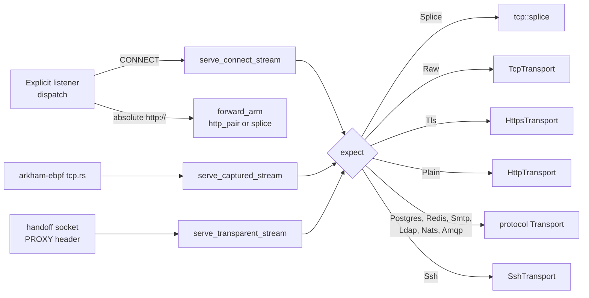
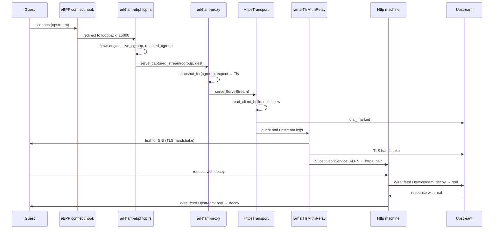
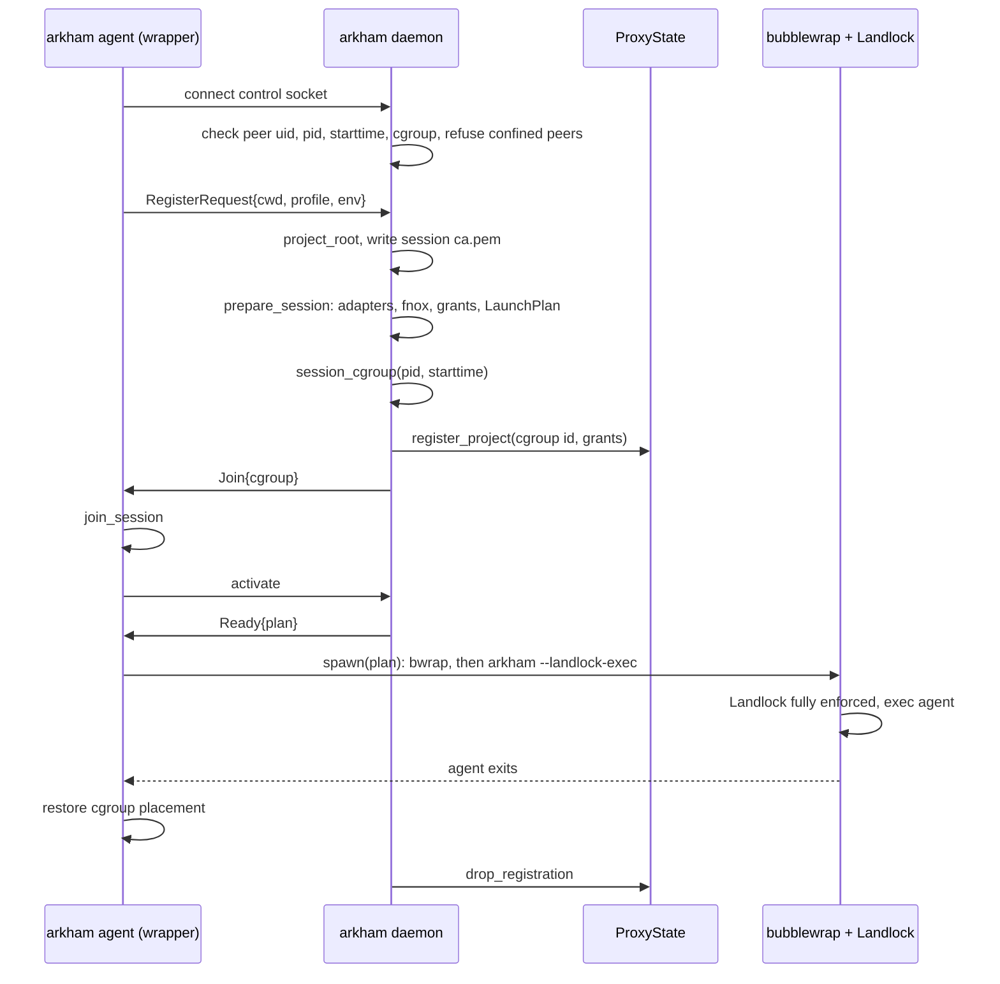

# arkham architecture map

Maps the code as it is on `main`. Locations are file paths and symbol names, not line numbers, so search for the symbol. `proxy/` means `crates/arkham-proxy/src/` and `grants/` means `crates/arkham-config/src/grants/`.

## 1. Crates

| Crate | Role | Key public items |
|---|---|---|
| `arkham` (bin, `src/`) | CLI with `serve`, `fake`, `schemes`, `ca`, `rules`, `config`, `registry`, `agent`, `daemon`. No subcommand means `serve`. | `Command` and `serve` in `main.rs`; `with_capture` in `main.rs`; `host::run`, `accept_loop`, `one_client` in `host.rs`; `daemon::systemd` |
| `arkham-proxy` | MITM core: ingress, protocol pick, TLS legs, relay, substitution. Every protocol vertical lives here. | `ProxyState`, `serve`, `bind_explicit`, `serve_connect_stream`, `serve_transparent_stream`, `serve_captured_stream` (`lib.rs`); `bind_handoff`, `serve_handoff` (`handoff.rs`); `Projects` (`projects.rs`) |
| `arkham-config` | Config overlay, rule schema, grants, registry, decoys, OAuth flows | `AppConfig`, `RuleCfg`, `fake_for` (`config.rs`); `Grant`, `resolve`, `uri_match` (`grants/resolve.rs`); `Scheme`, `HostPat`, `EndpointScope` (`grants/scope.rs`); `Registry`, `OAuthFlow` (`registry.rs`); `Cli`, `ProxyBackend` (`cli.rs`) |
| `arkham-fnox` | Resolves real values from fnox | `FnoxSource`, `resolve`, `export_provider_env` |
| `arkham-pki` | CA, leaf and client-pair minting, SSH keys | `CertAuthority`, `load_or_generate`, `generate_domain_pair`, `load_or_generate_client_pair` (`ca.rs`); `SshKey`, `load_or_generate_host_key`, `pinned_host_keys` (`ssh.rs`) |
| `arkham-plugin` | wasmtime component hosting for HTTP rewrite hooks | `RewriteHook`, `Registry::load`, `Registry::select` |
| `arkham-agent` | Wrapper side of `arkham agent` | `AgentArgs`; `agent` in `linux.rs` |
| `arkham-session-protocol` | Newline-framed control messages | `RegisterRequest`, `RegisterResponse` (`Join`, `Ready`, `Rejected`), `daemon_socket_path`, `trusted_socket` |
| `arkham-session` | Daemon-side session preparation | `prepare_session`, `PreparedSession` |
| `arkham-sandbox` | cgroups, bubblewrap, Landlock | `spawn`, `landlock_exec` (`linux.rs`); `session_cgroup`, `host_cgroup`, `join_session`, `SessionSlot` (`cgroup.rs`); `bwrap_argv` (`plan.rs`) |
| `arkham-launch-plan` | Launch data shared by preparation and confinement | `LaunchPlan`, `Bind` |
| `arkham-workspace` | Project discovery, secret selection, value expansion | `project_root` (`discover.rs`); `build_expander` (`expand.rs`) |
| `arkham-projection` | Forged twins and protected-path masks | `projection_files`, `protected_config_paths`, `projected_files` |
| `arkham-profiles` | Profile mount selection | `profile_mounts` |
| `arkham-paths` | Host and guest path operations | `Mount`, `translate`, `canonicalize_dir` |
| `arkham-tool-config` | Shared adapter output types | `RewriteAdapted`, `GrantFragment`, `DecoyFile`, `render_fragment` |
| `arkham-tool-{git,jj,kube,nats,ssh,talos}` | Per-tool config adapters (host config to guest decoy) | one `adapt` per crate |
| `arkham-git-config` | Git config discovery | `resolve` |
| `arkham-ebpf` | eBPF capture, userspace half | `run_ebpf` (`lib.rs`); `serve` (`tcp.rs`); `FlowTables` (`flow.rs`) |
| `arkham-ebpf-programs` | Kernel-side programs, bpf target only | `connect4` / `connect6` hooks and map ABI |
| `arkham-test-support` | Test-only env isolation | `IsolatedHome` |

A protocol is spread across `proxy/transports/
/`, `grants/
.rs`, and for some protocols an `arkham-tool-*` adapter.

## 2. Shared base that protocols must reuse

### 2a. Transport traits: `proxy/transports/halves.rs`

| Item | Shape |
|---|---|
| `ServeStream<'a, G, S>` | `{ guest, params: CandidateParams, scope }` |
| `Transport` | `type Scope; fn serve(&self, ServeStream<…>) -> impl Future<Output = Result<()>>` |
| `TlsHalves` | Required: `tls`, `tls_label`, `root_cert`, `client_paths`, `guest_tls`, `upstream_host`. Defaults: `guest_alpn`, `server_alpn`, `client_builder`, `client_config`, `accept_guest`, `connect_server`, `settle`. rustls only. |
| `TlsCache` | One per `ProxyState`: CA reread, guest leaf cache, upstream root cache |
| `within` | Bounds one handshake step by a budget |

`proxy/transports/legs.rs` holds the shared leg plumbing:

| Item | Role |
|---|---|
| `PairCtx` | `{ grants, host, port, plugins, mint }`, built by `PairCtx::new` |
| `open_flagged` / `FlaggedScope` / `FlaggedOpen` | Guest TLS opening when the scope is TLS, then `dial_marked` upstream. `FlaggedScope` is implemented for Redis, SMTP, LDAP, AMQP. |
| `Settled` | `Clear`, `GuestTls`, `ServerTls`, `Both` |
| `relay_settled!` | Relays whichever `Settled` combination came back |

**How a new protocol plugs in:** implement `Transport`; implement `TlsHalves` if it has TLS legs, overriding ALPN or `client_builder` only when the wire law differs; reuse `open_flagged` and `relay_settled!` if its opening fits; build its `(down, up)` pair from `PairCtx`.

### 2b. TLS caches and connection helpers

`proxy/transports/tls.rs`: `cached_leaf`, `cached_leaf_mtls` (client verifier on arkham's CA), and `cached_roots` (path or system store, fails closed when empty). The leaf key includes the ALPN offer.

`proxy/connection.rs`:

| Helper | What it does |
|---|---|
| `guest_tls_opening` | ClientHello, SNI and authority check, `MintBucket::allow` |
| `client_identity` | Loads the upstream client cert and key |
| `client_auth_policy` | boring mTLS policy (HTTPS only) |
| `trust_anchors` | Extra `root_cert` bundles |
| `dial_marked` | Upstream dial, 10 s budget, `SO_MARK` on Linux |
| `Prefixed` | Replays already-read bytes in front of a stream |
| `GuestIo` | Guest stream plus rama extensions for the HTTPS path |

### 2c. HTTPS stack (rama + boring)

- `ProxyState.relay` and `extra_relays` are rama `TlsMitmRelay`s built by `build_relays` in `projects.rs`: one global plus one per `root_cert` bundle.
- `HttpsTransport` (`proxy/transports/http/transport.rs`) reads the ClientHello, requires the SNI to match the CONNECT authority, takes a `MintBucket` token, dials, and hands both legs to `TlsMitmRelayService` with `SubstitutionService`.
- `SubstitutionService` picks the machine by negotiated ALPN: `https_h2_pair` for h2, `https_pair` for http/1.1, `raw_tls_pair` otherwise, then calls `relay_guarded`.
- Only HTTP and HTTPS use boring. Every other TLS protocol uses rustls through `TlsHalves`.

### 2d. Engine and relay

| Piece | Location | Notes |
|---|---|---|
| `Wire` | `engine/wire.rs` | `feed(chunk) -> (Rewritten, Vec<Hit>)` plus reply, peer-note, upgrade and handoff hooks |
| `Rewritten` | `engine/wire.rs` | `Emit` / `Hold` / `Close` |
| `Direction` | `engine/wire.rs` | `Downstream` swaps fake to real, `Upstream` real to fake |
| `CredentialPair` | `engine/wire.rs` | `{ needle, replacement, label }` |
| `eligible_pairs` | `engine/scan.rs` | Grants for a scheme, host, port and direction |
| `scan_with_tail`, `replace_bytes`, `replace_in`, `needle_safe_emit_len` | `engine/scan.rs` | Hold-back scanning shared by machines |
| `Raw` | `tcp/machine.rs` | `new` (equal length), `length_changing`, `from_pairs`; holds back longest needle minus one |
| `TcpTransport`, `splice` | `tcp/transport.rs` | `splice` replays read bytes, then `copy_bidirectional` |
| `relay_guarded` / `relay_stop` | `proxy/relay.rs` | `pump_requests` and `pump_responses` run together. `relay_stop` returns both sockets as `RelayEnd::Upgrade` for STARTTLS-style upgrades. |

**How a new protocol plugs in:** implement `Wire` for its framing and pass `(down, up)` to `relay_guarded`, or to `relay_stop` if it upgrades. Unframed bytes use `Raw`.

### 2e. Grants: `arkham-config/src/grants/`

- `scope.rs`: `HostPat` (`Exact`, `Wildcard`, `Any`), `Scheme` (14 variants, printed by `arkham schemes`), `Credential`, `GuestTlsMode`, `EndpointScope` and its `FromStr`, `SshScope`, `RootCert`.
- `resolve.rs`: `Grant` (`Token`, `Postgres`, `Redis`, `Smtp`, `Ldap`, `Nats`, `Amqp`, `Ssh`); `Grant::matches`, `endpoint`, and one lookup per protocol; `uri_match`; `resolve` into `ResolvedConfig`; `GrantCollector` with `connection_string`, `ssh`, `token`; `decoy_for_rule` (equal length for `tcp://`).
- `
.rs` for postgres, redis, smtp, ldap, nats, amqp: leg and scope types, `from_strings`, `matches`, `grant`.
- `RuleCfg::value_scheme` in `config.rs` routes connection-string values to `GrantCollector::connection_string`.
- `mod.rs` is module declarations and re-exports only.

**How a new protocol plugs in:** a `Scheme` variant plus its `EndpointScope::from_str` and default-port arms; `grants/
.rs`; a `Grant` variant with arms in `credential`, `matches`, and `connection_string` and a lookup fn; a `value_scheme` prefix.

### 2f. Fakes, OAuth, mint

- `fake_for(seed, pattern)` in `config.rs`: SHA-256 of the seed through a template, default `{hex:32}`. Wrappers: `Registry::decoy`, `decoy_for_rule`, `ContextIdentity::secret` (`context.rs`), `MintStore::mint`.
- `OAuthFlow` (`registry.rs`) rides on `Grant::Token.oauth2`; `flow_from_oidc` and `flows_from_openapi` in `import.rs` import flows.
- `mint_plan_for` and `mint_and_redact` (`engine/scan.rs`) mint decoys for token responses through `MintStore` (`proxy/mint.rs`). Only the HTTP h1 and h2 machines use it.
- `MintBucket` (`proxy/mint.rs`, `ProxyState.mint`) is the leaf-issuance burst guard (20 per 10 s), not OAuth.

### 2g. Plugins

`arkham_plugin::Registry::load` compiles the configured guests once. `select(scheme, host, port, Direction)` returns a fresh `Box<dyn RewriteHook>`. Only `http_pair` and `https_pair` call it; other protocols carry `PairCtx.plugins` and ignore it.

### 2h. Tool adapters (host config to guest decoy)

Each `arkham-tool-*` crate exposes one `adapt` returning `RewriteAdapted` (talos returns `TalosAdapted`, nats `AdaptedNats`). `arkham-session` calls them while preparing a session. Their grant fragments are written under `GRANTS_STATE_DIR` and merged before `grants::resolve`.

## 3. Per protocol

| Protocol | Proxy files | Path | Notes |
|---|---|---|---|
| http | `http/transport.rs`, `http/machine.rs` | `HttpTransport` → `http_pair` → `relay_guarded` | No grant: `raw_tcp_pair` |
| https | `http/transport.rs`, `http/machine.rs`, `http/h2.rs` | rama/boring, §2c | Mint and plugins |
| tcp | `tcp/` | `TcpTransport` → `Raw` → `relay_guarded` | Reference implementation |
| ssh | `ssh/transport.rs`, `ssh/legs.rs` | russh on both legs | No `TlsHalves`, no engine. Own `DashMap` key cache. |
| postgres | `postgres/` (`transport.rs`, `machine.rs`, `auth.rs`) | Own opening: `read_guest_opening`, `request_upstream_tls`, `auth::settle` | ALPN `postgresql`; `client_builder` uses `EgressCertVerifier` for libpq sslmodes |
| redis | `redis/` | `open_flagged` → `settle` → `relay_guarded` | |
| smtp | `smtp/` (`session.rs`) | `open_flagged` → `session::run` | STARTTLS inside the session; `Raw::length_changing` for replies |
| ldap | `ldap/` | `open_flagged` → `relay_stop` → StartTLS | |
| amqp | `amqp/` | `open_flagged` → `relay_guarded` | |
| nats | `nats/` | Own `ServerLeg`, `after_info`, `handshake_first` | Not on `FlaggedScope` |
| kube, talos | none | `Grant::Token` with an `https://` allow entry plus per-host mTLS | Adapter crates only |
| git, jj | none | HTTPS token grants plus SSH grants | Adapter crates only |

### Duplication

Each `grants/
.rs` (redis, smtp, ldap, amqp, postgres) defines its own leg and scope struct with the same host, port, password, TLS flag, cert and `guest_tls` fields. No shared type exists.

### Protocol knowledge in shared files

A new protocol still edits these:

- `engine/mod.rs` re-exports protocol machines and helpers.
- `engine/scan.rs` `grant_pattern` lists every `Grant` variant.
- `identity.rs` `Expect` has one arm per protocol, and `expect` and `Expect::serve` match on it.
- `lib.rs` `ProxyState` has one transport field per protocol.
- `grants/scope.rs`, `grants/resolve.rs`, and `RuleCfg::value_scheme` in `config.rs`.

Cleartext swaps the same credential as TLS. `proxy/cleartext_guard.rs` is a test that fails if a cleartext-only refusal comes back.

## 4. One connection, guest to upstream

Three ingress paths build `CandidateParams` and call `identity::expect`. `Expect::serve` is the only `match` that picks a transport.

`expect` checks the protocol lookups first (postgres, redis, smtp, ldap, nats, amqp, ssh), then https, http and tcp endpoints, and otherwise splices. CONNECT with no grant is spliced in `dispatch` before `serve_connect_stream`. `serve_captured_stream` selects the session's grants with `Projects::snapshot_for(cgroup)`; cgroup 0 or an unknown id uses the process-level config.

A granted HTTPS request captured by eBPF:

The explicit path is the same from `expect` on, after `dispatch` reads the CONNECT head and replies 200.

## 5. Processes

`arkham serve` (`main.rs` `serve`) resolves config, fnox and grants, builds `ProxyState`, binds the explicit listener and the handoff socket, and serves both. With `--proxy-backend ebpf` it runs `run_ebpf` beside them under `with_capture`, which ends the process if capture dies.

`arkham daemon` (`host.rs` `host::run`) starts `ProxyState` with no grants, binds the explicit listener and the control socket, attaches capture at `host_cgroup()` under `with_capture`, and accepts `arkham agent` registrations. Each session's grants live in `ProxyState.projects`, keyed by cgroup id.

## 6. `arkham agent`: registration and launch

The daemon keeps real credentials and materialised adapter files in private session storage. The launcher gets decoys, the CA certificate, and mount instructions; the plan reaches bwrap through a memfd. Protected paths hide the daemon's credential storage from the guest. Compose is used by integration fixtures only.

## 7. Runtime and dependency notes

- The root `Dockerfile` (base `ghcr.io/casualjim/bare:libcxx-udev-ssl`) is shared by the shipped image and the SSH, protocol, and Talos fixtures. Fixtures copy the debug `target/debug/arkham`; release images package the CI-built dist binary.
- Linux builds and tests run in the `arkham-dev` smolvm machine ([smolvm.md](smolvm.md)). Its image and the runtime base both come from Ubuntu 26.04, so the fixtures copy the `target/debug/arkham` built there.
- `fnox-core` comes from the `lotsaai/fnox` `fix/rsa-0.10` branch and `rama` from its upstream `main` branch, both as git dependencies in the root `Cargo.toml`. Accepted advisories and their removal conditions live in `.cargo/audit.toml`.
- NATS user JWT metadata is decoded with `base64` and `serde_json`. Arkham checks the header and user public key; the NATS server verifies the account signature.
